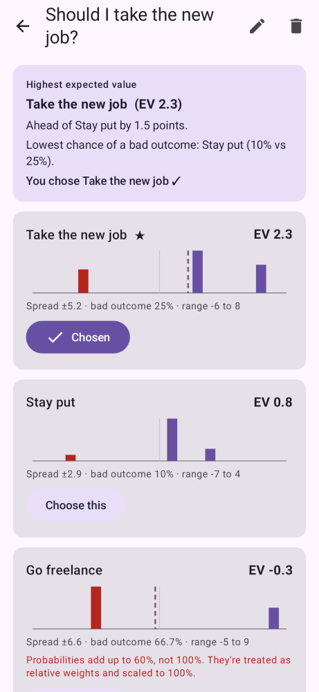
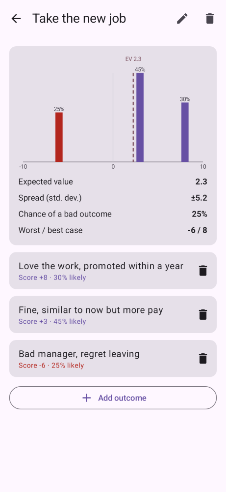
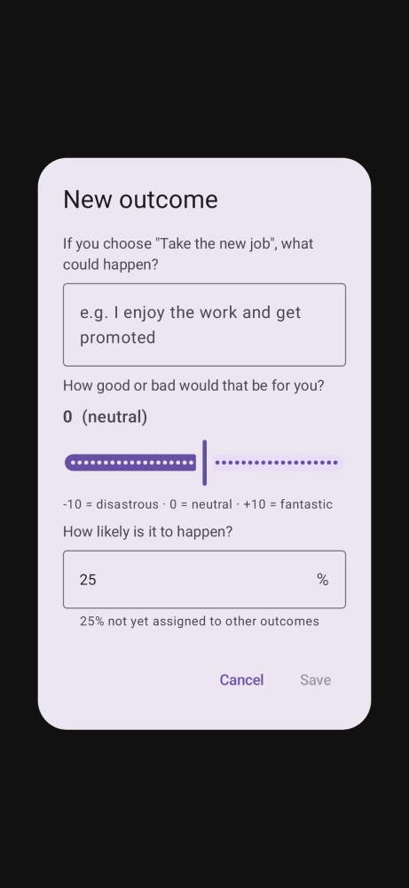

# Decide

A small, no-frills Android app for thinking through decisions with expected value.

For a decision you list your **options** (mutually exclusive: you pick exactly one). For each option the app asks:

1. *What could happen?* (an outcome)
2. *How good or bad would that be for you?* (a score from -10 to +10)
3. *How likely is it?* (a probability in %)

It then plots each option's outcome distribution as a probability histogram, works out the
**expected value** (EV), and ranks the options so you can see which has the highest EV and pick one.

| Compare options | One option | Adding an outcome |
|---|---|---|
|  |  |  |

## What it calculates

For an option with outcomes *i* with score *sᵢ* and probability *pᵢ*:

- **Expected value**: Σ pᵢ·sᵢ
- **Spread**: standard deviation, √Σ pᵢ·(sᵢ − EV)²
- **Chance of a bad outcome**: total probability of outcomes with a negative score
- **Worst / best case**

If an option's probabilities don't add up to 100%, they're treated as relative weights and
rescaled (the app shows a warning). Options are ranked by EV; the summary also points out the
option with the lowest chance of a bad outcome when that's a different one.

Data is stored locally on the phone (`decisions.json` in the app's private storage).

## Getting the APK

Every push runs the **Build APK** GitHub Actions workflow. Open the run under the repo's
*Actions* tab and download the `decide-apk` artifact, unzip it, and install `app-release.apk` on
your phone (you'll need to allow installing apps from unknown sources). It's signed with a debug
key, which is fine for personal use.

## Building locally

Requires JDK 17+ and the Android SDK (platform 35).

```sh
./gradlew testDebugUnitTest   # unit tests for the maths
./gradlew assembleDebug       # app/build/outputs/apk/debug/app-debug.apk
```

Or open the folder in Android Studio and press Run.

## Code layout

- `model/Model.kt`: data classes and the `Analysis` maths (pure Kotlin, unit-tested)
- `model/DecisionStore.kt`: in-memory state + JSON persistence
- `ui/Screens.kt`: decision list, decision comparison, and option screens (Jetpack Compose)
- `ui/Histogram.kt`: the histogram, drawn on a Compose `Canvas`
- `ui/Dialogs.kt`: the question prompts

## Ideas for later

- Relax mutual exclusivity (combinations of options)
- Risk-aversion: utility curves instead of raw EV
- Probability ranges / sensitivity analysis
